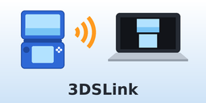

# 3DSLink



Stream your 3DS screens to a web browser over Wi-Fi. The 3DS hosts the page
itself, so a Chromebook (or any computer, tablet or phone) only needs Chrome. No
capture card, no Java and no desktop app. It works with Discord screen sharing.

- Top and bottom screens, live, while you play any game
- Layouts: **3DS** (stacked), **side by side**, **top only**, **bottom only**
- **Pop out** window with nothing but the screens, ready for Discord
- Quality and frame-rate controls in the browser
- Old 3DS / 2DS and New 3DS / 2DS XL

> **Status:** 0.2.0 is a ground-up rewrite. The streaming core and browser
> viewer are tested automatically against real Chromium, but the 3DS-side
> capture has not been tested on hardware yet. If something goes wrong, please
> open an issue with your model and what you saw.

## Install

You need a 3DS with [Luma3DS](https://github.com/LumaTeam/Luma3DS) custom
firmware and the FBI title manager (from the
[Homebrew Launcher](https://3ds.hacks.guide/) setup).

1. In FBI choose **Remote Install → Scan QR Code** and scan:

   

   (It points at the newest release:
   `https://github.com/AllPawsonDeck/3DSLink/releases/latest/download/3DSLink.cia`.
   You can also download `3DSLink.cia` from
   [Releases](https://github.com/AllPawsonDeck/3DSLink/releases), copy it to the
   SD card and install it with FBI.)
2. Open **3DSLink** from the HOME Menu. The first time, it installs its
   background streaming service. This takes a few seconds.

Only one CIA is needed. If you installed the old alpha builds (two CIAs), the
new app replaces both.

## Use

1. Connect the 3DS and the computer to the **same Wi-Fi network**.
2. Open **3DSLink** on the 3DS. The top screen shows an address such as
   `192.168.1.47:8080`. Type it into Chrome's address bar on your computer.
3. Press **HOME** and start a game. The stream keeps going in the background.

In the browser:

| Key | Action |
| --- | --- |
| `1` – `4` | 3DS / side by side / top / bottom layout |
| `P` | Pop out: a window with only the screens |
| `F` or double-click | Fullscreen |
| `H` | Hide or show the controls |
| `S` | Smooth or sharp pixel scaling |

**Discord:** click **Pop out**, then in Discord choose **Share Screen** and
pick the window called **3DSLink (pop-out)**. While the pop-out is open, the
main tab pauses, so the 3DS only streams once.

**Settings** (gear button) change image quality, frame-rate caps for each
screen, sharp colour, and the New 3DS speed boost. They are saved on the 3DS.

**Stopping:** open 3DSLink and press **X**, or hold **START + SELECT** for two
seconds in any game. Restarting the console also stops it.

### Getting the best picture

- Only the screens visible in your layout are sent. **Top** gives the top
  screen all of the 3DS's time and Wi-Fi.
- On an **Old 3DS**, start with quality around 50–60 and the **Top** layout.
  The CPU and Wi-Fi are slow, so expect a lower frame rate than on a New 3DS.
- On a **New 3DS**, encoding runs on the spare third CPU core, and the speed
  boost (on by default) runs the CPU at 804 MHz while you stream.
- A screen that isn't changing (a menu, a map) costs almost nothing: unchanged
  frames are detected and not resent.

### Troubleshooting

- **"Can't reach the 3DS"**: check that both devices are on the same network.
  Guest networks and some school or office Wi-Fi block devices from talking to
  each other. Phone hotspots usually work.
- **No address on the 3DS**: the 3DS isn't on Wi-Fi. Connect it under System
  Settings → Internet Settings. The app updates by itself.
- **"Service did not answer"**: press **A** in the app to restart the service.
  If it still fails, update Luma3DS, then hold **L + R** while opening 3DSLink
  to reinstall the service.
- **"Too many viewers"**: close other tabs or windows that are watching.
- The service log is at `http://<3ds-address>:8080/api/log`.

## How it works

```
3DSLink app (CIA)  ──installs/starts──▶  3DSLink service (background system module)
                                             │ 1. ask GSP where the visible framebuffers are
                                             │ 2. DMA-copy them in small strips
                                             │ 3. JPEG-encode (libjpeg-turbo) strip by strip
                                             │ 4. serve HTTP on port 8080
                                             ▼
                        Chrome  ◀── viewer page + MJPEG stream (multipart/x-mixed-replace)
```

- The service is a system module, so it keeps running while games play. On an
  Old 3DS it shares a very small memory region with the rest of the system, so
  everything is sized to fit in about 400 KB. Frames are copied 32 lines at a
  time and never fully decoded in memory.
- The 3DS stores its screens sideways. Frames are encoded in that native
  orientation and the browser turns them upright, which saves memory and time
  on the 3DS.
- The server is non-blocking and single-threaded. A slow viewer skips frames
  instead of building up delay, and doesn't slow down other viewers.
- API: `/stream?screens=top,bottom` (multipart JPEG; each part carries an
  `X-Screen` header), `/api/status`, `/api/settings?quality=60&fps_top=30`,
  `/api/log`.

## Building

Requirements: [devkitPro](https://devkitpro.org/wiki/Getting_Started) with
`3ds-dev` and `3ds-libjpeg-turbo`,
[makerom](https://github.com/3DSGuy/Project_CTR/releases) and
[bannertool](https://github.com/Epicpkmn11/bannertool/releases) on `PATH`.

```sh
make            # build/app/3DSLink.cia (with the service bundled inside)
make service    # build/service/3DSLinkService.cia on its own
```

The streaming core also builds on a normal PC with fake framebuffers, so the
viewer can be tested in a real browser without a 3DS:

```sh
sudo apt install libjpeg-turbo8-dev
make host && ./build/host/3dslink-host 8080   # then open http://localhost:8080
npm install --no-save playwright && npx playwright install chromium
make test                                    # end-to-end browser test
```

GitHub Actions builds every push and runs the browser test. To publish a
release (which the QR code above always points to), add a section for the new
version to [CHANGELOG.md](CHANGELOG.md), put the same number in `VERSION`, and
push to `main`. The release notes are built from the changelog, and the build
fails if the version has no changelog entry.

Other tools: `make art` redraws the icon and the flat banner picture
(`tools/make_art.py`), and `tools/cia_info.py` prints a CIA's title ID and
exheader basics. `tools/make_banner3d.py` is an experimental 3D banner
generator ([pycgfx](https://github.com/skyfloogle/pycgfx)); its output froze
the HOME Menu in 0.2.4, so it is not used in builds.

## Credits

- HzMod (by Sono) and
  [ChirunoMod](https://github.com/ChainSwordCS/ChirunoMod) pioneered
  framebuffer streaming from a background module on the 3DS and found how much
  memory an Old 3DS can spare. 3DSLink is a new implementation, but it follows
  their approach.
- [libctru](https://github.com/devkitPro/libctru), devkitARM,
  [libjpeg-turbo](https://libjpeg-turbo.org/),
  [Luma3DS](https://github.com/LumaTeam/Luma3DS).
- Install QR code: [Nayuki's QR Code generator](https://www.nayuki.io/page/qr-code-generator-library) (MIT).

## License

GPL-3.0. See [LICENSE](LICENSE).
`tools/vendor/qrcodegen.*` is MIT-licensed (see the file headers).
